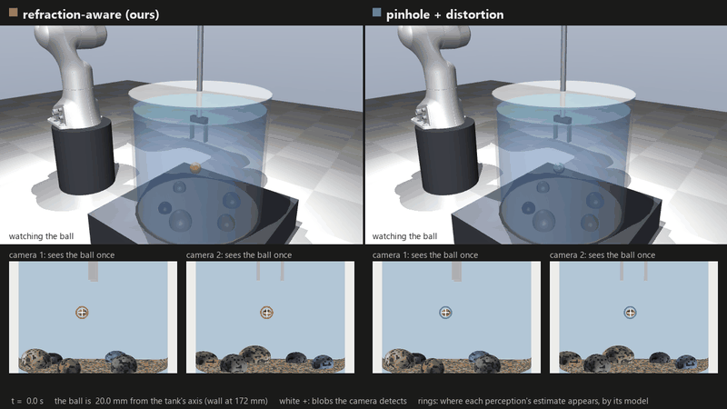
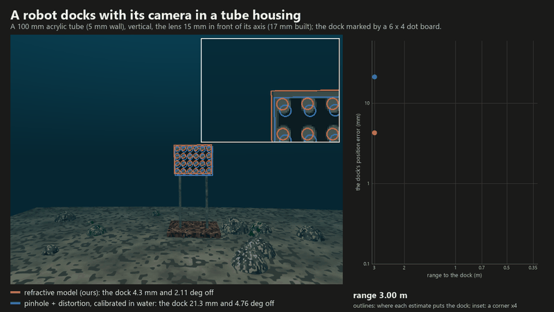
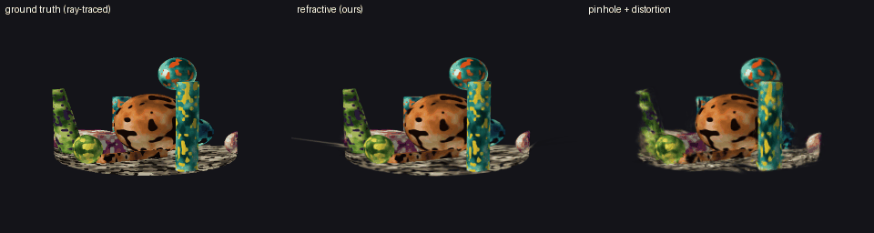
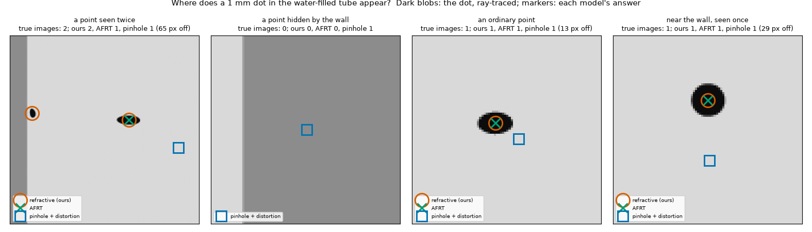
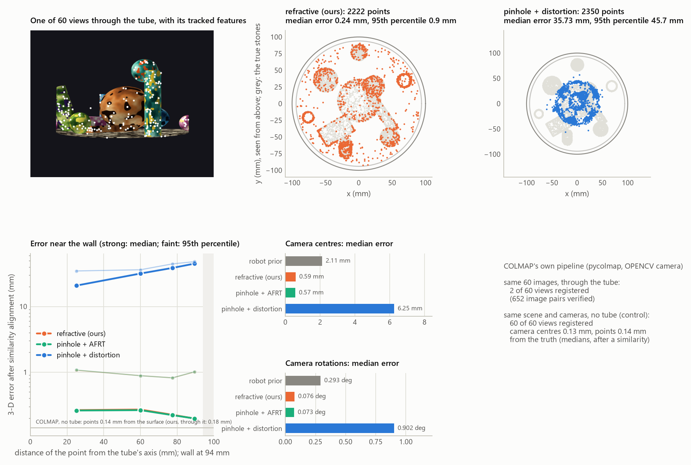
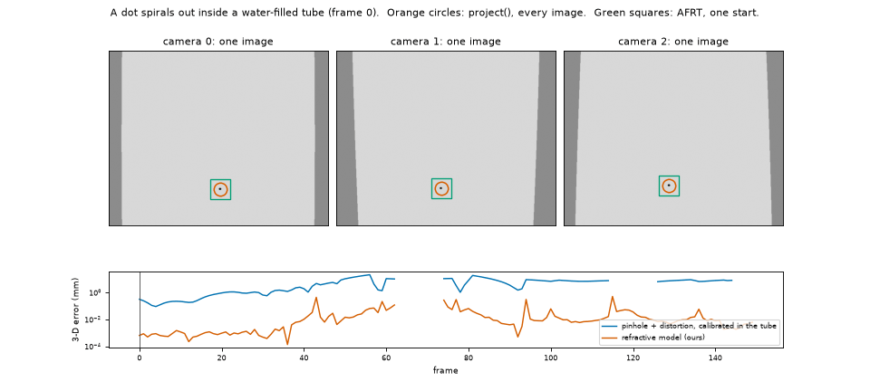

<h1 align="center">refractive-camera</h1>

<p align="center">
  <b>Camera models that see through curved windows.</b><br>
  For a point behind a water-filled tube, a tank, a dome port or a flat wall, <code>project()</code> finds
  <b>every</b> pixel where it appears (none, one or several) and the analytic derivative of each.
</p>

<p align="center">
  <a href="https://arxiv.org/abs/2610.17413"></a>
  
  <a href="LICENSE"></a>
  
</p>

<table>
  <tr>
    <td width="50%" valign="top">
      
      <br><b>Catching through a curved wall.</b> A Franka arm sees the ball only through the tank's wall. Ours (left)
      draws two rings where the wall shows the ball twice and none where it hides it; pinhole + distortion (right)
      misses 12 of 20 balls next to the wall. <a href="examples/demo_d_arm/README.md">Demo D</a>
    </td>
    <td width="50%" valign="top">
      
      <br><b>A camera inside its housing.</b> A robot docks through an acrylic tube. A pinhole camera calibrated in
      the water puts the dock 11 mm off; ours, 0.9 mm. The outlines show where each estimate puts the dock.
      <a href="examples/demo_e_housing/README.md">Demo E</a>
    </td>
  </tr>
  <tr>
    <td colspan="2">
      
      <br><b>Gaussian splatting through the tube.</b> Ray-traced truth, ours and the best pinhole model, from a camera
      circling the tube. <a href="examples/demo_c_splatting/README.md">Demo C</a>
    </td>
  </tr>
</table>

> [!NOTE]
> **Early development (0.1.0.dev0).** The projection is complete and validated (below); the API may still change.
> Robotics integration (NVIDIA Isaac Sim) is being prepared: [docs/isaac_validation.md](docs/isaac_validation.md).

## Highlights

- 🔍 **Complete.** Every image of every point, from closed-form ray equations and a certified search: both images
  where a wall shows a point twice, none where it hides it. A point with no image is reported as hidden, not as a
  failed search.
- 🔁 **Either side of the window.** A camera looking into a tank, a tube or a flask, or out of a dome port or a
  cylindrical housing.
- 📐 **Differentiable.** The analytic Jacobian of every image, in its point and in the camera's pose, for every window.
  A splatting step needs 68 ms per view with it, against 7.6 s for an iterative method with finite differences.
- ✅ **Checked independently.** Every ray is traced back by a vector-Snell tracer that shares none of the closed forms,
  and image lists are compared with a brute-force search by tracing alone.
- ⚡ **Fast.** A compiled core: about 0.13 ms per point on one thread, 0.02–0.03 ms on all cores.

## Why

A tank, a tube or a dome bends every ray that passes through its wall. A point inside can appear displaced, stretched,
**twice**, or **not at all**, and where it appears depends on the camera's pose as well as on the point. A pinhole
camera with lens distortion cannot represent that, even when it is calibrated through the window.
- **The pinhole camera.** In Demo A it is off by about a millimetre even where it was calibrated, and by 8 mm (up to
  22 mm) near the wall.
- **The refractive model** is good to a micrometre wherever the target's image is undistorted.

Iterative ray-shooting methods find one image from one starting guess, so a point with two images comes back with
one. When they return nothing, the point may be hidden, or the search may simply have failed (see the benchmark).
`project()` returns the complete list of images for every point.

## Install

```sh
pip install .            # from a checkout; builds the compiled core if a C++17 compiler is available
```

- **Requirements.** Python 3.10 or later, NumPy and mpmath.
- **Without a compiler** the package installs as pure Python. That is the same search, about 100 times slower.
- **Check.** `refractive_camera.available_backends()` says which backends you have.
- **Optional dependencies:**

  | Extra | Adds | For |
  |---|---|---|
  | `.[demo]` | matplotlib, scipy, Pillow | Demo A, the figures |
  | `.[sfm]` | OpenCV, pycolmap | Demo B |
  | `.[splat]` | PyTorch | Demo C |
  | `.[robot]` | MuJoCo, imageio | Demo D |
  | `.[housing]` | OpenCV | Demo E |
  | `.[test]` | pytest | the tests |

## Quick start

```python
import numpy as np
import refractive_camera as rc

# An acrylic tube (outer radius 100 mm, wall 6 mm) filled with water, seen from air; lengths in metres
tube = rc.CylindricalWindow(radii=(0.100, 0.094), indices=(1.0, 1.49, 1.33))
cam = rc.Camera.look_at(position=(0.35, 0.0, 0.0), target=(0.0, 0.0, 0.0), f=2000.0, size=(1280, 1024))

points = np.array([[0.020, 0.030, 0.010],          # an ordinary point
                   [-0.0621, 0.0610, 0.0],         # a point the camera sees twice
                   [0.0038, 0.0869, 0.0]])         # a point hidden by the wall
images = rc.project(points, cam, tube)
print(images.counts())          # [1 2 0]: images per point
print(images.uv)                # one pixel per image; images.point says whose
```

**From inside.** A window lists its media from the outermost inward, whichever side the camera is on. A camera in
air behind a dome port under water is

```python
dome = rc.SphericalWindow(radii=(0.100, 0.094), indices=(1.33, 1.49, 1.0))      # water, acrylic, air
cam = rc.Camera.look_at(position=(0.0, 0.0, -0.020), target=(0.0, 0.0, 1.0), up=(0.0, -1.0, 0.0),
                        f=600.0, size=(1280, 1024))                           # 20 mm behind the dome's centre
images = rc.project([[0.30, 0.10, 0.80]], cam, dome)  # 1 image, 11 px from where a pinhole camera puts it
```

- `python examples/quickstart.py`: the first example in full.
- `python examples/quickstart_inside.py`: the dome port, and a camera in a water-filled tube looking out. That camera
  sees some points twice and others not at all, and half of its pixels see only the wall's reflection.

## What's in the package

`project()` handles any number of coaxial cylinders, concentric spheres or parallel planes (`CylindricalWindow`,
`SphericalWindow`, `FlatWindow`), in any position and orientation, with the camera outside a curved window or inside
it. Each result row carries the pixel and whether it falls on the sensor, the branch (the ray meets the point before
or after its closest approach to the axis), the ray's conserved momenta and its direction at the camera.

| | |
|---|---|
| `trace()`, `back_project()` | Vector-Snell ray tracing through the window, from outside or inside: from pixels to the line each one sees across the window |
| `triangulate()` | A point from pixels in two or more cameras: back-projected lines, then reprojection refinement |
| `image_jacobians()` | How each image's pixel moves with its point and with the camera's pose, for every window and either side: analytic, for bundle adjustment and differentiable rendering |
| `scene.render_scene()` | A ray-traced renderer of textured objects across the window (and in front of it), with the true hit point of every pixel |
| `render_dots()` | A small ray-traced renderer of dots across the window, for synthetic data |
| `tracing.search_images()` | A brute-force image search by tracing alone, used to validate `project()` |
| `baselines.afrt()` | A published iterative method (AFRT, Belden 2013), for comparison |
| `isaac` | Conversions between Isaac Sim / USD cameras and `Camera` (no Isaac Sim import) |

Conventions (OpenCV cameras; a curved window's media listed from the outermost inward, whichever side the camera is
on) are in [docs/conventions.md](docs/conventions.md).

## Where does a point appear?

Through a curved window the question has 0, 1 or 2 answers. Three camera models answer it for points in the
water-filled reference tube:
- **`project()`;**
- **AFRT,** an iterative method from one start;
- **a pinhole camera with OpenCV distortion,** the model of OpenCV, COLMAP and ROS, here calibrated through the
  tube on points filling the water: its best case.

The truth comes from a brute-force search by tracing ([benchmarks/cases.py](benchmarks/README.md)).

| Points | `project()` | AFRT, one start | Pinhole + distortion |
|---|---:|---:|---:|
| ordinary, anywhere in the water | **100 %** | 99 % | 2 % (13 px off) |
| seen twice | **100 %** | 0 %: one of the two | 0 % (52 px off) |
| hidden by the wall | **100 %** | 100 % | 0 %: it "sees" every one |
| at the edge of the two-image band | **100 %** | 0 % | 0 % (47 px off) |
| within 9 mm of the wall | **100 %** | 94 % | 0 % (30 px off) |



<details>
<summary><b>Why a calibrated pinhole camera cannot absorb a curved window</b></summary>

The pinhole + distortion camera is the camera model of OpenCV and COLMAP: a pinhole projection with focal lengths
and a principal point, and a lens polynomial in the radius, (k1, k2, k3), plus tangential terms (p1, p2).
Calibrating it through the window lets the polynomial absorb what it can of the refraction. It cannot absorb
everything:
- the bending depends on the point's depth along the ray, not only on its direction;
- the refracted rays do not meet at one centre;
- through a curved window a point can have two images, or none, while a lens maps each point to exactly one.

</details>

## Demos

Five demos, each with its README, its script and its numbers. Every image they use is ray-traced through the window
by the package's own renderer (`refractive_camera.scene`), which uses none of the projection's equations, so no
comparison is circular.

| Demo | What it shows | Refractive model (ours) | Without a refractive model |
|---|---|---|---|
| [A. Locating a target](examples/demo_a_localization/README.md) | three cameras track a 1 mm dot in the tube | 0.001 mm rms near the axis, 0.09 mm near the wall | pinhole + distortion: 0.94 mm and 8.1 mm |
| [B. Structure from motion](examples/demo_b_sfm/README.md) | a robot-held camera circles the tube; 60 views give its poses and the stones inside | 0.24 mm (median 3-D error), from robot priors of 2 mm | pinhole + distortion: 36 mm; COLMAP: 2 of 60 views registered (60 of 60 without the tube) |
| [C. Gaussian splatting](examples/demo_c_splatting/README.md) | 3-D Gaussian splatting of the stones, each Gaussian drawn at every image; the same Gaussians drawn with the tube taken away; training from a robot's poses | 31.9 dB test PSNR (28.8 dB from new poses); Gaussians 1.0 mm from the true surface; 31.5 dB without the tube; 30.1 dB from a robot's poses, refined as it trains | AFRT's images + our Jacobian: 31.8 dB (28.9 dB), 1.0 mm; AFRT alone (no formula of ours), both on equal terms with a mask of the water: 33.1 dB (30.1 dB) against ours' 33.3 dB (30.1 dB), 4.4 h of training against ours' 65 min; pinhole + distortion: 24.0 dB (22.2 dB), 2.1 mm, 21.8 dB without the tube; pinhole: 23.3 dB (21.4 dB), 3.9 mm, 19.1 dB |
| [D. A robot arm catches a ball](examples/demo_d_arm/README.md) | a Franka with a slim gripper reaches into a water tank; it sees the ball only through the wall; then it puts a needle at the ball's centre | 40 of 40 caught, 20 of 20 next to the wall; the needle within 0.5 mm of the centre in 20 of 20 placements next to the wall (at most 0.05 mm off), 1.8 s per estimate | pinhole + AFRT: 40 of 40, 20 of 20; needle 5 of 20 (blob centroids), 20 of 20 with AFRT alone fitting the whole ball (at most 0.36 mm off) at 33 s per estimate; pinhole + distortion: 28 of 40, 8 of 20; needle 0 of 20 |
| [E. A camera in an underwater housing](examples/demo_e_housing/README.md) | one camera behind a flat port, behind a dome port and inside a tube, calibrated in the water; a robot docks with it | under 0.0001 px off when calibrated on exact pixels; docking through the tube: the dock 0.9 mm off at 1–3 m, 0.5 mm in the final metre | pinhole + distortion calibrated in the water (on exact pixels): up to 77 px off through the tube, 40 px through the flat port, 0.45 px through the dome; docking through the tube: 11 mm off |

> [!TIP]
> Each demo keeps its renders and trained models in a `_cache/` folder beside it. Set `REFCAM_CACHE` to keep them
> elsewhere.

**What the comparisons show:**
- **A pinhole camera cannot stand in for a curved window,** even calibrated through it. Its errors are millimetres to
  centimetres, and they grow towards the wall: next to it, it caught 8 balls of 20 (D).
- **To triangulate a target, one image per camera is enough.** Any image, traced back through the wall, gives a ray
  through the target, so an iterative method from one start (AFRT) ties with `project()` in tracking and catching
  (A, D) and in bundle adjustment (B).
- **Where the projection itself is the measurement, the complete projection and its derivative count:**
  - **the ball's whole image** (D, part 3): ours fits the ball to its stretched, clipped or doubled blobs to 0.03 mm
    next to the wall, against 1.4 mm for AFRT and for ours from centroids;
  - **one camera** (D, part 3): where it sees the ball twice, its two rays cross at the ball; ours locates it to
    0.5 mm, while AFRT, knowing one image, gets a ray;
  - **splatting** (C): pixels that show an image AFRT does not find render at 14.5 dB against 11.7 dB, and the Jacobian
    a rasterizer needs costs 68 ms per view for ours, against 7.6 s for AFRT with finite differences.

  In Demos B and C the AFRT variants were given our Jacobian, so their scores there isolate which images each method
  finds.
- **AFRT on its own,** with no formula of the refraction model (its own iterations, its derivatives by finite
  differences), matches ours where one image per point is enough, at a multiple of the time:
  - bundle adjustment (B): the same accuracy, at about four times the time;
  - the needle task (D, part 4), fitted to the whole ball: like ours, it lands all 20 placements next to the wall
    within 0.5 mm. Within 0.1 mm it lands 17, against ours' 20, and it takes 18 times the time per estimate;
  - splatting (C), with its own images and footprints, both drawing in training every image they are scored on and
    with a mask of the water: level with ours over the whole image (33.1 against 33.3 dB), 0.2–0.3 dB behind next to
    the wall, at four times the training time. With the demo's defaults it had led by 0.6 dB, because the demo trains
    ours on fewer images than it scores; Demo C's README traces why.

  What it cannot do stays the same: the second image of a point, and telling a hidden point from a failed search.
- **A camera inside its housing** (E): a pinhole + distortion calibrated in the water is nearly exact behind a dome
  port (0.45 px), wrong close up behind a flat port (40 px at 0.15 m), and wrong at every range inside a tube (4–10
  px at 1–4 m, 50 px at 0.15 m). Ours calibrates the camera's place in its housing with the analytic derivatives.
  It has no model error in any of the three (under 0.0001 px on exact pixels), and docking through the tube it puts
  the dock within a millimetre where the pinhole is a centimetre off.



### Demo A: locating a target through a water-filled tube

`python examples/demo_a_localization/demo_a.py` (about 6 minutes; [details](examples/demo_a_localization/README.md))



- **The scene.** Three cameras watch a 1 mm dot inside the reference tube. The dot spirals out to the wall, then
  circles it.
- **Localisation.** The dot is located from the detected blobs in two ways: with the refractive model, and with a
  pinhole camera with lens distortion calibrated through the tube on a dot grid near the axis.

| 3-D error | Inside the pinhole's calibration volume | Outside it |
|---|---:|---:|
| Refractive model (`project()`, `triangulate()`) | 0.001 mm rms | 0.09 mm rms |
| Pinhole + distortion, calibrated through the tube | 0.94 mm rms | 8.1 mm rms (up to 22 mm) |

**The dot hidden or seen twice.** Each camera loses the dot in the wall's shadow in about 30 of the 150 frames, and
sees it twice in 5.
- `project()` predicts both events.
- AFRT returns one of the two images.
- The pinhole camera knows neither.

## Validation and speed

The benchmark ([benchmarks/](benchmarks/README.md)) runs at the paper's reference port, with 550 points per window
(cylinder and sphere): uniform, two-image, edge of the shadow, steep and near-axis. Every answer is scored against a
brute-force search that uses tracing alone.

| Points | `project()` | AFRT, one start |
|---|---:|---:|
| Uniform in the water: complete and correct | 100 % | 97–100 % |
| Difficult sets pooled: complete and correct | 100 % | 63 % |
| Two-image points: both images returned | 100 % | 0 % |

**Speed.** The compiled core takes about 0.13 ms per point at the median on one thread, and a batch runs at 0.02–0.03
ms per point on all cores of a desktop CPU (the benchmark). A camera inside a window needs one search per point:
about 0.2 ms per point on one thread and 0.02 ms on all cores. All were timed on a busy machine.

**Against AFRT.** On easy points one AFRT start is faster. What it cannot do is return every image, or tell a
hidden point from a failed search.

The checks are listed in [docs/validation.md](docs/validation.md):
- every ray `project()` returns is traced back through the window;
- every image list is compared with a brute-force search that uses tracing alone;
- the two backends are compared on thousands of points;
- results are checked to be the same in any length unit and frame.

## Scope

**Supported now:**
- A camera **outside** coaxial cylindrical or concentric spherical interfaces, looking at points inside the
  innermost one: tubes, pipes, tanks, flasks.
- A camera **inside** them, looking at points outside the outermost one: a camera in a cylindrical housing or behind
  a dome port, or a camera submerged in a tube or a tank.
  - In its least dense medium (air) the camera sees every point exactly once.
  - In a denser one (water) it can see a point twice, or not at all.
- A camera on one side of parallel planar interfaces, looking at points on the other: tank walls, flat ports. A flat
  window gives every point exactly one image.
- Any number of interfaces and any positive refractive indices.
- Analytic derivatives of every image with respect to its point and to the camera's pose, for all of these.

**Not yet:**
- A camera between two interfaces (in a wall).
- Non-concentric or deforming interfaces.
- Brightness: the model gives where an image is, not how bright it is.

Rounding can lose a ray that grazes an interface to within about 5e-14 of the grazing limit: its image sits on the
very edge of the wall's shadow.

## Citation

If you use this package, please cite the method:

S. Zhong, S. Tan, X. Zhang, Y. Li and R. Ni, "A complete forward projection algorithm through cylindrical and
spherical refractive windows", [arXiv:2610.17413](https://arxiv.org/abs/2610.17413) (2026).

```bibtex
@misc{zhong2026refractive,
  title         = {A complete forward projection algorithm through cylindrical and spherical refractive windows},
  author        = {Zhong, S. and Tan, S. and Zhang, X. and Li, Y. and Ni, R.},
  year          = {2026},
  eprint        = {2610.17413},
  archivePrefix = {arXiv}
}
```

## License and contact

MIT (see [LICENSE](LICENSE)). Shijie Zhong (szhong12@jhu.edu), Ni Research Lab, Johns Hopkins University.
