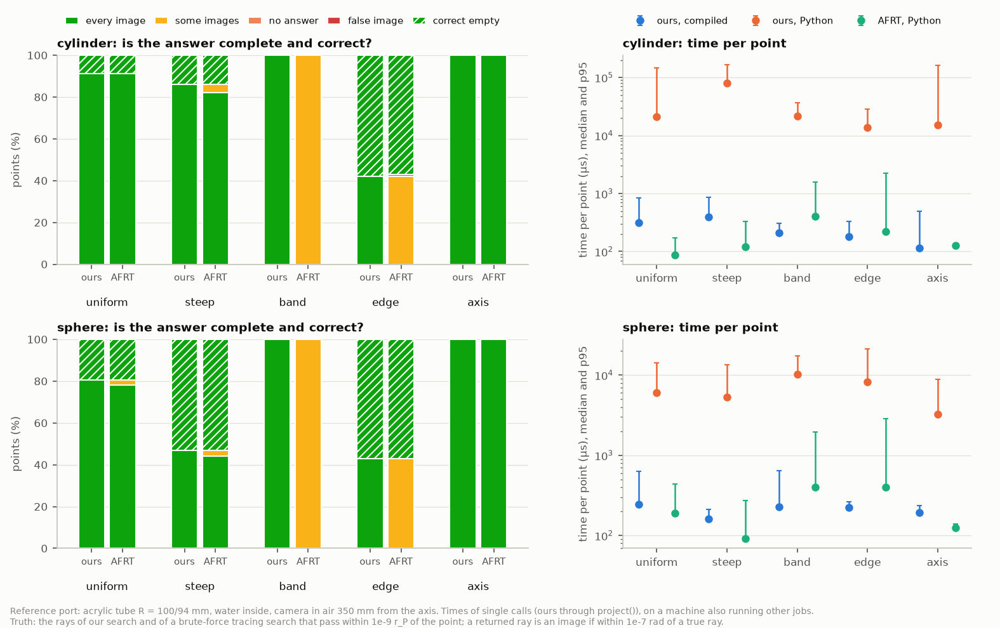

# Benchmark: projection through the reference port

`bench_projection.py` measures, for the paper's reference port, how long one forward projection takes and whether it
returns every image of the point:
- **Paper:** S. Zhong et al., [arXiv:2610.17413](https://arxiv.org/abs/2610.17413).
- **Port:** an acrylic tube, outer radius 100 mm and wall 6 mm, filled with water and seen from air, with the camera
  350 mm from the axis. The same port made spherical is measured too.

**Methods:**
- **ours, compiled:** `refractive_camera.project(backend="cpp")`, the complete search.
- **ours, Python:** the same search in pure Python.
- **AFRT:** alternating forward ray tracing (Belden 2013) from one start, the straight line to the point, as
  published.

**Point sets:**
- **uniform:** uniform in the water.
- **steep:** points far above or below the camera.
- **band:** points with two images.
- **edge:** points next to the edge of the shadow.
- **axis:** points within 2 mm of the cylinder's axis, or of the sphere's line through its centre and the camera.

**Truth:**
- At a point, the truth is every ray found by our search or by a brute-force search that uses tracing alone
  (`refractive_camera.tracing.search_images`), kept only if its traced path passes within 1e-9 r_P of the point.
- A returned ray is an image when its direction is within 1e-7 rad of a true ray, which is 2e-4 px at f = 2000 px.
- An answer is then scored as one of: every image, some images, no answer, a false image, or a correct empty answer.

```
python benchmarks/bench_projection.py            # about 11 minutes; writes bench_projection_out.txt, .json, .png
python benchmarks/bench_projection.py --quick    # a minute, small sets
python benchmarks/bench_projection.py --redraw   # the figure again, from the JSON
```

It needs the compiled core (`pip install .` with a C++17 compiler, or `python setup.py build_ext --inplace`) and
matplotlib.

## Results of 21 October 2026



**Complete and correct answer** (every image, or a correct empty answer):

| window | set | points scored | ours | AFRT, one start |
|---|---|---:|---:|---:|
| cylinder | uniform | 150 | 100 % | 100 % |
| | steep | 100 | 100 % | 96 % (4 %: one of two images) |
| | band (two images) | 100 | 100 % | 0 % (one of two images at every point) |
| | edge of the shadow | 100 | 100 % | 57 % (42 %: one of two images; 1 %: a false image) |
| | axis | 100 | 100 % | 100 % |
| sphere | uniform | 150 | 100 % | 97.3 % (2.7 %: one of two images) |
| | steep | 100 | 100 % | 97 % (3 %: one of two images) |
| | band (two images) | 100 | 100 % | 0 % (one of two images at every point) |
| | edge of the shadow | 100 | 100 % | 57 % (43 %: one of two images) |
| | axis | 100 | 100 % | 100 % |

The edge sets mix shadow points with two-image points. AFRT is right at the shadow points, where it returns nothing,
and finds one of the two images at every two-image point:
- **Edge, cylinder:** 57 correct empty answers, 42 points with one of two images, 1 false image.
- **Edge, sphere:** 57 correct empty answers, 43 points with one of two images.

Pooled over the four difficult sets, AFRT is complete at 63.2 % (cylinder) and 63.5 % (sphere) of the points.

**Agreement with the brute force.** Our search agrees with the brute-force truth at every scored point (550 per
window). No AFRT ray was missing from the truth.

**AFRT's false image** came from its only non-converged run (2,000 iterations), at a shadow point. Elsewhere it
returned nothing at the shadow points, which is the right answer there.

**Precision of the returned images** (distance from the point to the traced ray):
- ours: median 8.7e-17 m and largest 8.6e-12 m (cylinder); median 3.1e-17 m and largest 1.6e-12 m (sphere);
- AFRT: median 6.5e-10 m and largest 9.8e-10 m (cylinder); median 6.3e-10 m and largest 9.9e-10 m (sphere). Its stopping
  tolerance is 1e-9 m.

**Time per point, uniform set, medians:**

| window | ours, `project()` | ours, core only | ours, Python | AFRT, Python | ours, batch, 1 thread | ours, batch, all cores |
|---|---:|---:|---:|---:|---:|---:|
| cylinder | 310 µs | 128 µs | 21 ms | 88 µs | 154 µs | 28 µs |
| sphere | 245 µs | 124 µs | 6.0 ms | 191 µs | 101 µs | 16 µs |

**How to read the times:**
- **Easy points.** On easy points one AFRT start is the faster call, and it is complete at nearly every uniform point.
  What it cannot do is return both images of a two-image point.
- **No like-for-like comparison.** Ours (compiled) is C++ behind a Python call; the `project()` column includes about
  100–200 µs of NumPy wrapper per single-point call, which a batch call amortises. AFRT here is pure Python. The
  paper compares both in C++ (its Section 9.2.1).
- **Load.** The machine was about 75 % busy with other jobs during this run (sampled per set, in the output). These
  timings are therefore inflated and noisy: in one row (sphere, band) the core alone timed slower than through
  `project()`.
- **Clean numbers.** Rerun on a quiet machine for clean numbers.

**Machine:** Intel Core i9-13900K, Windows 11 (build 26200), Python 3.11.16, NumPy 2.4.6. The compiled core was
built by `setup.py` with MSVC 19.40 (`/O2 /GL /std:c++17`).
