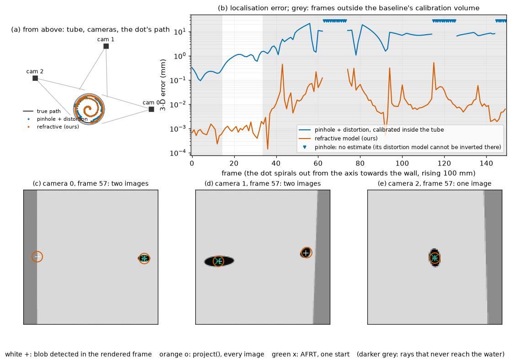

# Demo A: locating a target through a water-filled tube

```sh
python examples/demo_a_localization/demo_a.py            # 150 frames, about 6 minutes with 8 processes
python examples/demo_a_localization/demo_a.py --frames 15 # a quick look
```

It needs `pip install .[demo]` (matplotlib, scipy, Pillow). It writes `demo_a_out.txt` (every number below),
`results.json`, `summary.png` and `animation.gif` beside the script.

## The set-up

- **The tube.** The paper's reference port: an acrylic tube 200 mm across with 6 mm walls (n = 1.49), filled with
  water (n = 1.33).
- **The cameras.** Three cameras outside it, in air, 0.40–0.42 m from its axis, 75° apart and at slightly different
  heights. Each is 1280 × 1024 px with f = 2200 px and a mild barrel distortion of its own lens (k1 = −0.08,
  k2 = 0.02).
- **The target.** A dot of radius 1 mm moves through 150 frames, rising 100 mm in all.
  - In the first 50 frames it spirals out from 5 mm off the axis to 87 mm.
  - It then goes once round the tube at 87 mm, its surface 6 mm from the inner wall.
  - On the way round, each camera's view crosses the wall's shadow, where the dot cannot be seen at all, and the
    bands where it is seen twice.

## The observations: rendered, not computed

Each camera's frames are rendered by `refractive_camera.render_dots`, which traces the camera's pixel rays through
the tube with Snell's law: half resolution to find the dot, then a supersampled crop for each blob. The dot is
detected as dark blobs, and each blob's intensity-weighted centroid is the measurement. None of the projection's
equations is used to make the observations, so the comparison below is not circular.

A finite dot's image is not the image of its centre. Near the wall the tube's magnification changes across the dot,
and the blob's centroid moves away from the projection of the dot's centre (see the numbers). That is a property of
the target, not of either model.

## What is compared

**Where the dot appears.**
- `project()` predicts every image of the dot's centre in each camera.
- AFRT, from one start (Belden 2013, a published iterative method), predicts at most one.
- Each prediction is matched to the detected blobs within 5 px. Two images of one dot are always farther apart than
  that here.

**Where the dot is.**
- **Refractive model (ours).** Every blob's pixel is back-projected through the tube, both images when a camera sees
  two. The lines are intersected in the least-squares sense, and the point is then refined by minimising the
  reprojection error with `project()`. Cameras and tube are known exactly, as after a calibration that gets them
  right.
- **Pinhole with distortion, unaware of refraction.** This is what a robotics user would do without a refractive
  model. Each camera is calibrated through the tube on a 3-D dot grid filling r ≤ 60 mm and |z| ≤ 40 mm, observed
  with 0.1 px of noise:
  - **fitted:** fx, fy, cx, cy, k1, k2, p1, p2, k3, rotation and translation, by least squares, starting from the
    true camera;
  - **triangulation:** the largest blob in each camera gives a straight ray, and the rays are intersected.

## Results (`demo_a_out.txt`)



### Where the dot appears

The run has 450 camera-frames. In 89 the dot's centre has no image (the wall's shadow), in 346 it has one, and in
15 it has two.

| | images matched to detected blobs | missed | extra blobs |
|---|---:|---:|---:|
| `project()` | 371 of 379 blobs | 5 | 8 |
| AFRT, one start | 358 | 3 | 21 |

- **`project()`.** Blob centroids lie 0.014 px from the predicted images at the median, and 0.22 px at the 95th
  percentile.
- **AFRT.** It returned nothing at all 89 shadow frames, which is right. At each of the 15 two-image frames it
  returned one of the two images.
- **The 13 mismatches of `project()`** all fall in 9 camera-frames where the 1 mm dot straddles the edge of the
  shadow or of the two-image band. Part of the dot's surface is seen there and part is not: projecting 200 points of
  its surface gives different image counts.
  - In five of these frames the centre is hidden but an edge of the dot shows.
  - In two, an image is a sliver too thin to detect.
  - In two, partial images join into one blob.

  `project()` describes the dot's centre; near those edges a finite target is only partly seen.

### Where the dot is

3-D error in mm:

| | inside the calibration volume (19 frames) | outside it (131 frames) |
|---|---|---|
| refractive model (ours) | rms 0.0011, max 0.0020 | rms 0.086, max 0.52 |
| pinhole + distortion | rms 0.94, max 1.45 | rms 8.1, max 21.6 |

- **Ours outside, without the 9 edge frames:** rms 0.038 mm and max 0.28 mm.
- **Frames with no estimate:** ours 11 (where fewer than two cameras see the dot) and the baseline 27. In the other 16
  the baseline cannot invert its own distortion model.

**What the numbers say:**
- **The tube is not a pinhole camera.** Fitted on the grid, each pinhole camera moves 1.5–2.4 m from the axis instead
  of 0.40 m and zooms in to focal lengths (fx and fy) of 8,900–14,500 px. It still misses the grid by 8 px rms. So it is off by about a
  millimetre even where it was calibrated, and by 8 mm rms (up to 22 mm) near the wall.
- **The refractive model** is good to about a micrometre where the dot's image is undistorted.
  - Near the wall its error grows to tenths of a millimetre. There the finite dot's centroid moves up to 3.6 px from
    the image of its centre.
  - That bias belongs to the target, not to the model. A smaller target, or a model of the blob's shape, would remove
    it.

**Cost** (one thread, on a machine busy with other jobs; the times vary by a few per cent between runs):
- `project()` takes about 0.5 ms per single-point call through the Python API.
- The refractive localization of a frame takes about 37 ms: back-projection plus reprojection refinement, with three
  cameras.
- The straight-ray baseline takes about 1 ms.
- AFRT takes about 0.17 ms per call in pure Python, on these mostly easy points.
