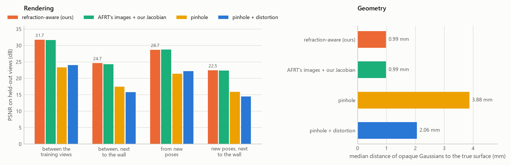
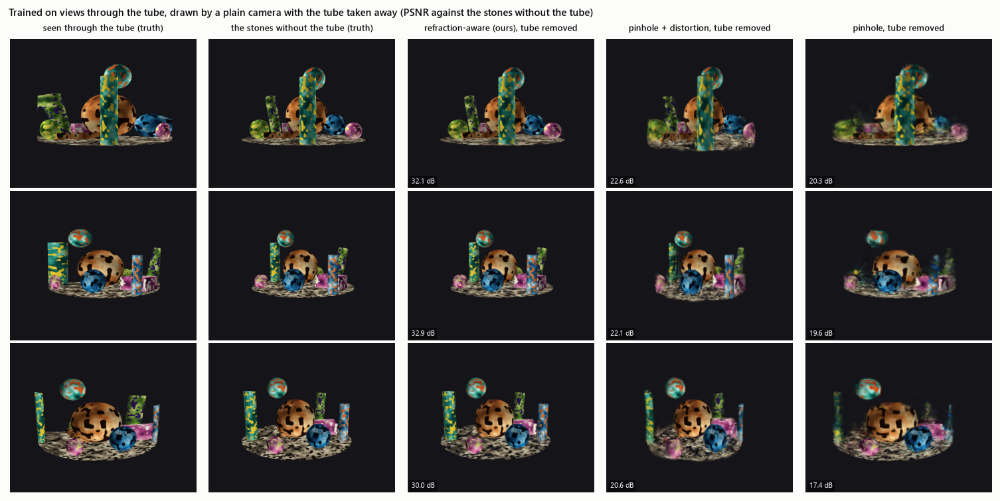
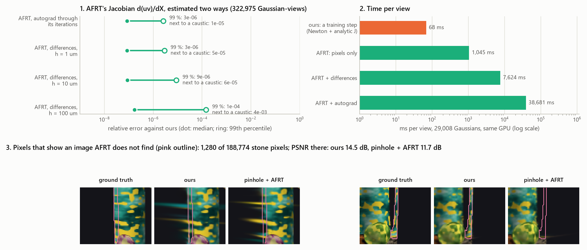
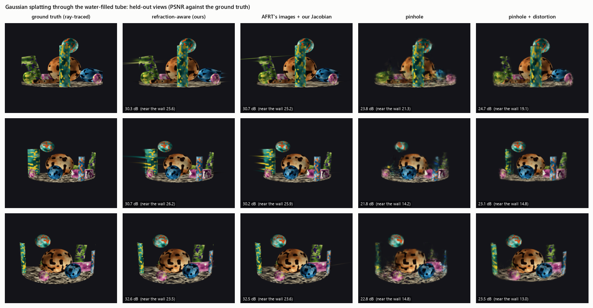

# Demo C: Gaussian splatting through a water-filled tube

```sh
python examples/demo_c_splatting/demo_c.py              # ours, pinhole, pinhole + distortion: about 1.5 hours on a 4 GB GPU
python examples/demo_c_splatting/demo_c.py --models afrt
python examples/demo_c_splatting/demo_c.py --models refractive_noisy,refractive_refined   # from a robot's poses
python examples/demo_c_splatting/derivatives.py         # the Jacobian AFRT would need, and the images it misses
python examples/demo_c_splatting/figures.py             # the figures below, and orbit.gif
```

It needs `pip install .[splat]` (PyTorch; CUDA optional). The rasterizer is plain PyTorch, so nothing has to be
compiled. Renders, models and intermediate results go to `_cache/`, which is not committed.


## Why splatting needs a forward projection, and its derivative

3-D Gaussian splatting draws each Gaussian where its centre projects, with a footprint `J Σ Jᵀ` from the
projection's Jacobian `J`, and its gradients flow back through the same projection. That is what makes it fast: it
never traces a ray.
- **Ray-marching methods** (NeRF) need only back-projection, which through a window is easy tracing.
- **A rasterizer** needs the forward projection, and through a curved window that has more than one answer:
  - near the wall a Gaussian must be drawn **twice**, in the band where the tube shows a point twice;
  - or **not at all**, in the wall's shadow.

  A pinhole camera, with any distortion, has exactly one answer per point.
- **It also needs the derivative** of that projection, for every image of every Gaussian at every step. Ours is the
  implicit-function derivative of the closed form: one 2 × 2 solve on terms the projection has already evaluated.

## The set-up

- **The scene:** the stones of Demo B in the paper's reference tube (acrylic, water).
- **The views:** 48 training views on three rings around the tube, and 12 test views between them; 320 × 256 px.
- **Ground truth:** ray-traced by `refractive_camera.scene`, which contains no Gaussians.
- **The cameras** train the same small 3D Gaussian splatting (`splat.py`). They share the rasterizer, the
  initialisation (10,000 random Gaussians in the water), the schedule (4,000 steps, densification from step 300 to
  2,500) and the losses (L1 and SSIM).

| Camera | Where a Gaussian is drawn |
|---|---|
| **refractive (ours)** | at every image `project()` returns. The footprint comes from the analytic Jacobian of that image, and the depth order from the ray's length. |
| AFRT's images + our Jacobian | ours, but each Gaussian's images come from one AFRT start: at most one image, none where AFRT fails. Our Newton tracking and Jacobian do the rest, so it differs from ours only in which images it knows. |
| pinhole | the true camera, the window ignored |
| pinhole + distortion | each camera's own OpenCV model, fitted through the tube to points of the scene volume: the best a pinhole can do |

**How ours trains:**
- The images of each Gaussian are found by `project()` (complete) for each view, every 500 steps.
- In between, each image's momenta (Λ, C_z) follow its Gaussian by Newton's method from their last value.
- Gradients flow through one Newton step taken with autograd. That is the implicit-function derivative of the
  projection; it was checked against the analytic Jacobian to 1e-14.
- New Gaussians from densification start from their parents' images.
- Splats next to a caustic, where the Jacobian blows up, are left out and counted.

## Results (`demo_c_out.txt`)

Two sets of test views:
- **between the training views:** 12 views on the training rings;
- **from new poses:** 12 views closer and higher, or farther and lower, than any training view. This is where a robot
  that moves its camera would look from.

PSNR is given over the whole image, and over the pixels where the camera sees a stone within 15 mm of the wall.

| Camera | Between the training views | ... near the wall | From new poses | ... near the wall | SSIM (between, new) | Opaque Gaussians to the true surface |
|---|---:|---:|---:|---:|---:|---:|
| **refractive (ours)** | **31.7 dB** | **24.7 dB** | **28.7 dB** | **22.5 dB** | 0.979, 0.959 | **0.99 mm** median (51 % within 1 mm) |
| AFRT's images + our Jacobian | 31.7 dB | 24.3 dB | 28.8 dB | 22.4 dB | 0.979, 0.959 | 0.99 mm (51 %) |
| pinhole | 23.3 dB | 17.5 dB | 21.4 dB | 15.9 dB | 0.899, 0.824 | 3.9 mm (18 %) |
| pinhole + distortion | 24.0 dB | 15.8 dB | 22.2 dB | 14.5 dB | 0.904, 0.860 | 2.1 mm (18 %) |



**What the numbers say:**
- **The refractive camera is 7–8 dB ahead between the training views, and 6.5 dB ahead from new poses.** Its
  Gaussians sit on the stones: half of the opaque ones are within 1 mm of the true surface.
- **The pinhole cameras learn a different scene,** one that looks right from close to the training views. From new
  poses it falls further behind, and its Gaussians lie 2–4 mm from the stones at the median.
  - Per-camera distortion, fitted through the tube to 2.8 px rms, helps a little overall.
  - It does worse next to the wall, where a polynomial cannot follow the tube.
- **AFRT's images, given our Jacobian, tie with ours** within run-to-run variation (±0.5 dB per view, either way).
  Ours is ahead next to the wall, where it draws the second images. Why the two are this close is the streaks' story
  below.

**Training:** 4,000 steps, about 37 minutes for ours and 29 for a pinhole, on a GTX 1630 (4 GB). Ours ends with 29,008
Gaussians.

## Take the tube away

Every image above is a view through the tube, distortion and all. The Gaussians are not: ours sit where the stones
are. Drawn by a plain camera with the tube taken away, the same trained models compare with the stones ray-traced
with no tube (`without_tube.json`, 3 test views):

| Model, trained through the tube | Drawn without the tube |
|---|---:|
| **refractive (ours)** | **31.6 dB** |
| pinhole + distortion | 21.8 dB |
| pinhole | 19.1 dB |



Ours shows the stones as they are, as sharp as its views through the tube. The pinhole models built the tube's
distortion into the stones themselves. One reconstruction gives a robot both: what its camera will see through the
wall, and the scene behind it.

## The images AFRT misses, and the derivative it lacks (`derivatives.py`)

Measured on ours' trained Gaussians in the 12 test views, on the same GPU, with a batched PyTorch AFRT
(`afrt_torch.py`, the library's AFRT to 2e-16):

| | |
|---|---|
| **Pixels that show an image AFRT does not find** | 1,280 of 188,774 stone pixels, in 10 of 12 views |
| PSNR there | ours 14.5 dB, AFRT's images 11.7 dB |
| **The Jacobian `d(uv)/dX`**, which AFRT does not return | central differences of AFRT, or autograd through its iterations: both within ~1e-7 of ours at the median (1e-5 to 4e-3 next to a caustic) |
| Time per view, 29,008 Gaussians | **ours, a training step: 68 ms** · AFRT, pixels only: 1.0 s · AFRT + differences: 7.6 s · AFRT + autograd: 38.7 s |

AFRT cannot tell a hidden point from a slow one, so a batch runs to its iteration cap (300).



## The streaks next to the caustics

Ours' renders show short streaks next to the tube's caustics (the left crop above). They are not the double image.
They come from the footprint:
- `J Σ Jᵀ` assumes the projection is linear across the Gaussian.
- Next to a caustic, where a point's two images merge and then vanish into the shadow, the projection is a square-root
  fold. `J` grows without bound, while the true image of a Gaussian stays short and ends at the caustic.
- The linear footprint is long and symmetric, so it smears across the caustic.

The double images lie in the same band next to the caustic, so the two go together: 60–66 % of the footprints wider
than 16 px belong to Gaussians a view shows twice, against 3 % of all images.

Rendering ours' own trained Gaussians four ways (development campaign, T18) shows the trade:

| ours' trained Gaussians, rendered with | between views | new poses | next to the wall (between / new) | streak pixels (between / new) |
|---|---:|---:|---:|---:|
| every image, footprints capped at 48 px (as trained) | 31.74 | 28.69 | 24.66 / 22.46 | 24.47 / 20.15 |
| footprints capped at 16 px | 31.83 | 28.75 | 24.64 / 22.49 | 24.91 / 20.47 |
| one image per Gaussian, AFRT's | 31.86 | 28.89 | 24.35 / 22.26 | 25.12 / 20.82 |
| the unscented footprint where the linear one is wider than 6 px (`splat.render_ut`) | 31.86 | 28.79 | 24.63 / 22.46 | 24.94 / 20.74 |

- **Dropping the second images helps the whole image,** because some carry streaks, and **hurts next to the wall,**
  where they are real content. That is why a model that never draws them can come out ahead on some views.
- **The unscented footprint** projects six sigma points of the Gaussian on the image's own branch, so the points
  beyond the caustic have no image and the footprint stays on the side where the Gaussian is seen. It needs every
  image and each one's branch. Used only where the linear footprint is wider than 6 px, it removes the long streaks
  at render time, without retraining. Training with it (`--footprint hybrid`) is the next step.

## Training from a robot's poses (`--models refractive_noisy,refractive_refined`)

A robot knows where its camera is only to a millimetre or two. Here the 48 training poses are off by 1.8 mm and 0.29°
(rms), as Demo B's prior.
- `refractive_noisy` trains from those poses as they are;
- `refractive_refined` refines them with the Gaussians (`splat.PoseSplatCamera`). The gradient in the camera's pose
  comes from the same implicit-function step: the camera's position enters the closed form through r_P, φ_P and z_P,
  and its rotation turns the ray into a pixel. It equals `image_jacobians`' pose derivative to 1e-13. AFRT would need
  twelve more runs per Gaussian, per view, per step for it.

(Results follow when the runs finish.)



## Checks

In the development campaign:
- **The splat camera against `project()`:** the same 264 images, pixels within 3e-12 px, Jacobians within 5e-14.
- **Gradients:** its autograd gradient equals the analytic Jacobian (1e-14); its pose gradient equals
  `image_jacobians` (1e-13) and central differences of `project()` (2e-8).
- **Warm starts:** Newton from the previous momenta agrees with a fresh `project()` after a 0.2 mm move (4e-12 px).
- **The rasterizer** passes `gradcheck`, and matches a brute-force per-pixel sum (1e-16).
- **A footprint against Monte-Carlo:** a 1 mm Gaussian's drawn mean and covariance agree with 20,000 samples
  projected by `project()`. The mean is within 0.02 px and the covariance within about 1 %.
- **The batched AFRT** equals the library's AFRT: same convergence on 2,000 point-camera pairs, directions within
  2.2e-16.

**Limits:**
- the images are synthetic and view-independent (no reflections, no Fresnel);
- the linear footprint's Jacobian is held constant in the backward pass;
- the splats are clamped next to caustics.
