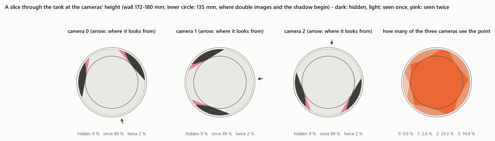
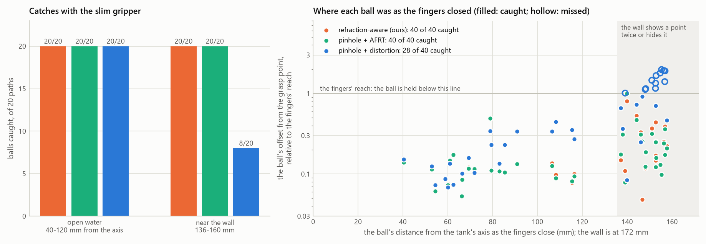
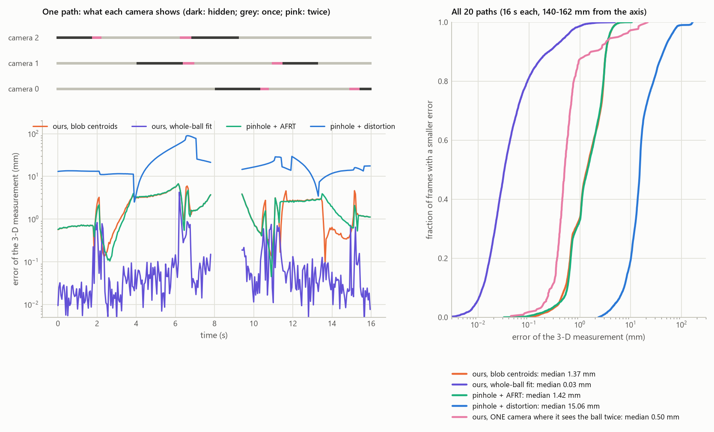
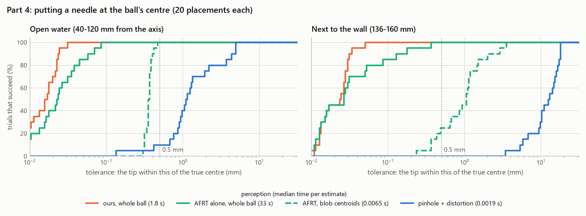

# Demo D: a robot arm catches a ball in a water tank, seen through the wall

```sh
python examples/demo_d_arm/demo_d.py --kinds refractive,afrt,pinhole   # 40 ball paths x 3 perceptions, ~15 min
python examples/demo_d_arm/fold_zone.py                                # parts 2-3: tracking next to the wall
python examples/demo_d_arm/precision.py --workers 5                     # part 4: a needle at the ball's centre, ~7 min
python examples/demo_d_arm/video.py --seed 9                           # catch.mp4 and catch.gif
python examples/demo_d_arm/figures.py                                  # summary.png, visibility.png, fold_zone.png
```

It needs `pip install .[robot]` (MuJoCo, imageio). On first run the Franka Panda model is downloaded from
[MuJoCo Menagerie](https://github.com/google-deepmind/mujoco_menagerie/tree/main/franka_emika_panda) (Apache-2.0)
into `_cache/`, which is not committed (set `REFCAM_CACHE` to put the caches elsewhere).


## The task

- **The tank:** an acrylic cylinder 36 cm across (8 mm wall, n = 1.49), filled with water (n = 1.33) to 30 cm.
- **The ball:** an orange ball 16 mm across swims inside. It starts near the axis and spirals out, on each of 40
  random paths, to its circle:
  - 20 paths stay in the open water, 40–120 mm from the axis;
  - 20 swim out to 136–160 mm, where the wall shows a point twice or hides it (beyond 180 mm / 1.33 = 135 mm).
- **The arm:** a Franka Panda on a 25 cm pedestal holds a **slim long-reach gripper**:
  - a 14 mm shaft 30 cm long, and two thin fingers (14 mm wide, 50 mm long) that open to 40 mm and close along the
    tank's tangent;
  - the Panda's own hand is 208 mm across its closing direction, so it fits inside this tank only around points within
    93 mm of the axis. The slim tool reaches the whole tank.
- **The tank is solid:** its wall, floor and stones are collision geometry, so a touch shows as a contact and counts as a
  failed catch.
- **The catch:** the tool waits in the water above the axis while the cameras pick the ball up. After 4.5 s it moves over
  the ball, goes down to it, and closes. From 30 mm away it stops using the cameras, whose view its own fingers would
  block, and closes on the filter's prediction.
- **A catch counts** if, as the fingers reach the ball, the ball lies between them (within 12 mm along the closing
  direction, 9 mm across it and 17 mm along the fingers), and the robot never touched the tank. The ball's motion is
  scripted (MuJoCo has no buoyancy), and it has no contact with the fingers.

**What the arm knows** comes only from three cameras outside the tank (640 × 512 px, f = 800 px, 0.7 m from its
axis). Their frames are **ray-traced through the curved wall** by `refractive_camera.scene`, with the ball, the tool
and the stones in the water.
- **Detection:** the ball is found in each frame as an orange blob, coarse to fine as in Demo A. The tool can hide it.
- **Tracking:** each perception feeds a constant-velocity Kalman filter at 20 Hz. Its prediction guides the tool.

| Perception | How it locates the ball |
|---|---|
| **refraction-aware (ours)** | `project()` predicts every image of the ball in every camera, so a blob is associated even where a camera sees the ball twice, and no camera waits for a ball it cannot see. The blobs are triangulated through the wall (`triangulate`). |
| **pinhole + AFRT** | the refraction-aware perception, but each camera's predicted image comes from one AFRT start: at most one image, none where AFRT fails. Triangulation from the blobs' traced rays. |
| **pinhole + distortion** | each camera's own OpenCV model, calibrated through the tank on a 3-D target in its middle (r ≤ 80 mm; fits of 1.3 px rms), as a user unaware of refraction would do. Straight-ray triangulation. |

**Calibration.**
- **The two refraction-aware perceptions** (ours and pinhole + AFRT) are given the cameras' and the tank's true
  parameters, as a perfect calibration through the tank would give them. So no calibration error enters them here.
  Demo E calibrates the refractive model from images instead.
- **Pinhole + distortion** has no such parameters to be given. Each camera's model is fitted through the tank to
  3,000 points of its middle, with 0.1 px of noise: its best case.

**Nothing is learned.** The arm is driven by damped least-squares inverse kinematics toward the filter's prediction,
through a scripted sequence (wait, approach, descend, close, lift). The thresholds of the sequence were set by hand.



## Part 1: catches (`demo_d_out.txt`)

| Perception | Caught | Open water | Next to the wall | Estimate's error as the fingers close (median, max) | Touched the tank |
|---|---:|---:|---:|---:|---:|
| **refraction-aware (ours)** | **40 of 40** | 20 of 20 | **20 of 20** | 1.1 mm, 6.9 mm | 0 |
| pinhole + AFRT | 40 of 40 | 20 of 20 | 20 of 20 | 1.4 mm, 8.6 mm | 0 |
| pinhole + distortion | 28 of 40 | 20 of 20 | 8 of 20 | 4.0 mm, 19.4 mm | 0 |



- **In the open water all three catch every ball.** There the tank is a mild lens, and the pinhole model was
  calibrated there.
- **Next to the wall the pinhole model misses 12 of 20.** Its estimate is off by 12 mm at the median as the fingers
  close, against 2 mm for ours, and its straight rays do not know where the wall shows the ball twice or hides it.
- **Pinhole + AFRT ties with ours,** and that is expected: any image of the ball, traced back through the wall, gives a
  ray through the ball, so a triangulation does not need the second image AFRT misses. Next to the wall the cameras hid
  the ball in 9 % of their frames before the catch and showed it twice in 2 %; one AFRT start found every visible ball
  (checked at 6 radii × 720 azimuths × 3 cameras). Part 3 shows where it falls short.
- **No trial touched the tank.** The tool centre point is kept 10 mm inside the wall, and the open fingers clear it.

## Part 2: tracking where the wall hides or doubles the ball (`fold_zone.py`)

On 20 paths of 16 s the ball swims 140–162 mm from the axis, and the perceptions track it. There is no arm: this
measures what each perception knows. Each camera loses the ball in the wall's shadow in 22 % of its frames, sees it
twice in 4.5 %, and once otherwise; one AFRT start found the visible ball in every camera-frame.

| Perception | 3-D measurement error, median | 95th pct. | Kalman estimate, median | Kalman estimate, max |
|---|---:|---:|---:|---:|
| **ours, whole-ball fit (part 3)** | **0.03 mm** | **0.52 mm** | **0.12 mm** | 30 mm |
| ours, blob centroids | 1.37 mm | 3.76 mm | 1.49 mm | 16.5 mm |
| pinhole + AFRT | 1.42 mm | 3.72 mm | 1.50 mm | 16.5 mm |
| pinhole + distortion | 15 mm | 60 mm | 15 mm | 169 mm |

Every perception measures the ball in the same 95 % of frames. In the other 5 %, at least two cameras lose the ball in
the wall's shadow, nothing can be triangulated, and each Kalman filter coasts on its constant-velocity prediction.



- **From blob centroids, ours and AFRT tie** at about 1.4 mm. Any image of the ball, traced back, gives a ray through
  it; AFRT misses only second images, and one image is enough. Their error grows from 0.4 mm in the open water to
  1.4 mm because a blob's centroid is no longer the image of the ball's centre (below).
- **The pinhole model is off by 15 mm at the median** and up to 17 cm: the ball swims about twice as far from the axis
  as its calibration target reached (80 mm).
- **The filters coast through the gaps.** The longest last 1.5 s, while only one camera sees the ball. On a circle a
  constant-velocity prediction drifts outwards by about ½ r ω² t², up to 30 mm here, and the remaining camera sees
  that drift nearly along its ray. That is the filter, not the perception: the estimate snaps back within a frame of
  the next measurement (0.2 mm for the whole-ball fit). The centroid filters drifted less on these paths by chance:
  their velocity, biased by the stretched blobs, happened to point inwards.

## Part 3: the whole ball, and one camera

Next to the wall a camera sees the ball stretched, clipped at the shadow's edge, or twice, and two copies may merge into
one blob; a blob's centroid is then not the image of the ball's centre. `ball_image.py` predicts the blobs from the
model instead:
- points spread over the ball's surface are projected by `project()`, which gives every image of each;
- an image counts if its ray meets the surface from outside;
- it is weighted by the area it covers in the image, from `image_jacobians`, and by how the detector weighs its colour;
- the ball's centre is fitted so that the predicted blob centroids match the measured ones (Gauss-Newton, with the
  centroids' analytic derivative).

**Results** (`fold_zone_out.txt`): the fit measures the ball to **0.03 mm** at the median next to the wall, 40 times
better than the centroids (1.37 mm for ours, 1.42 mm for AFRT; table above).
- It needs every image of the ball's surface (where the wall shows part of it twice, or clips it) and the Jacobian of
  each. One AFRT start gives one image per surface point and no derivative; with finite differences of its own
  iterations it can make the same fit, at about 18 times the cost (part 4).
- A ray tracer could predict the same blobs by rendering each guess of the ball's position, at the cost of rendering
  frames inside a fit.

**One camera** is then enough where it sees the ball twice: its two rays cross at the ball, 7–22° apart in the water,
so the camera is a stereo pair.
- **Ours** pairs the two blobs with one point and fits it. In the 267 camera-frames of part 2 where a camera showed the
  ball as two blobs, the fit was accepted in 82 %, with an error of **0.50 mm** at the median (90th percentile
  1.7 mm), from one camera. The two rays' crossing alone is 17 mm off: the stretched blobs' centroids are not the
  images of the ball's centre, and two rays from one camera cross at a shallow angle.
- **Pinhole + AFRT:** one AFRT start knows one image, so the camera gives a ray, not a point.
- **Pinhole + distortion:** two straight lines from one centre meet only there.

## Part 4: putting a needle at the ball's centre (`precision.py`)

The ball rests at a point of the tank, and the arm, holding a needle on the slim tool's shaft, must put the needle's
tip at the ball's centre.
- **What the arm sees:** the three tank cameras' frames, taken with the needle parked above the water.
- **How it moves:** it brings the tip onto the perception's estimate and servos it there with its own joint angles,
  to 0.001 mm, so the perception alone decides.
- **Success:** the tip ends within 0.5 mm of the true centre, and the robot never touches the tank.
- **Placements:** 20 in the open water (40–120 mm from the axis) and 20 next to the wall (136–160 mm).

| Perception | How it locates the ball | The window's closed forms |
|---|---|---|
| **ours, whole ball** | part 3's fit: every image of the ball's surface by `project()`, weighted with `image_jacobians`, with two safeguards next to the caustic (below) | used |
| AFRT alone, whole ball | the same fit with AFRT only: each surface point's image from one AFRT start, every derivative by finite differences of AFRT (`afrt_ball.py`) | none |
| AFRT, blob centroids | parts 1–2's AFRT perception | none |
| pinhole + distortion | parts 1–2 | none |

**Results** (`precision_out.txt`):

| Perception | Open water: succeed, median error | Next to the wall: succeed, median error | Next to the wall: largest error | Time per estimate |
|---|---:|---:|---:|---:|
| **ours, whole ball** | **20 of 20**, 0.016 mm | **20 of 20**, 0.024 mm | **0.05 mm** | **1.8 s** |
| AFRT alone, whole ball | 20 of 20, 0.023 mm | 20 of 20, 0.026 mm | 0.36 mm | 33 s |
| AFRT, blob centroids | 20 of 20, 0.35 mm | 5 of 20, 1.0 mm | 3.5 mm | 0.007 s |
| pinhole + distortion | 2 of 20, 1.1 mm | 0 of 20, 12 mm | 18 mm | 0.002 s |



- **Fitting the whole ball is what lands the needle next to the wall.** From blob centroids AFRT succeeds in 5 of 20
  placements there; fitted to the whole ball, in 20.
- **AFRT alone can make that fit, at 18 times the cost,** and it lands every placement within 0.5 mm. Next to the wall
  it is less precise: 17 of 20 placements within 0.1 mm, against 20 of 20 for ours.
  - In its two largest errors (0.18 and 0.36 mm), one camera's blob shows about a fifth of its surface points twice:
    the wall shows that part of the ball twice, and the two copies merge into one blob. AFRT finds one image per
    point, so it mispredicts that blob.
  - Its third error above 0.1 mm (0.13 mm) has no double image. Its cause was not traced.
  - Where the two copies make separate blobs, AFRT leaves the blob it cannot predict out of the fit, which costs
    nothing here.
- **Ours predicts every blob and uses it,** in 1.8 s per estimate, with the derivative in closed form. In the open
  water it is also the most precise: every tip within 0.03 mm.
- **The detector.** Part 4 samples its coarse pass every 2 × 2 pixels (parts 1–3: 4 × 4). At 4 × 4 it missed a small
  second copy of the ball (17 px of 430, 53 px from the main blob), exactly a part that AFRT does not predict, and
  that biased ours' fit in one trial.

### Where the fit missed, and two safeguards

Without the two safeguards below, ours missed one placement next to the wall (0.52 mm from the centre), and AFRT
alone missed two (0.86 and 1.53 mm).
- **It was neither the projection nor a stuck fit.** The ball sat 137.7 mm from the axis, just past where the wall
  starts to hide points or show them twice (135 mm). Camera 2 saw it across the caustic: a fifth of the ball's
  surface had no image there and a quarter had two, smeared into a 46 px streak that ends at the caustic. The fit's
  cost was lower at its estimate (0.47 px²) than at the true centre (1.63 px²). It had found the best match to a
  prediction that was off.
- **400 surface points were too few there.** The fit predicts each blob from 400 points on the ball, each weighted by
  the image area it covers. Next to the caustic that area grows without bound, so the one or two points nearest to it
  decide the prediction.
  - At the true centre, camera 2's prediction was 1.3 px off with 400 points, 0.9 px with 1,600, 5.3 px with 6,400
    and 0.03 px with 25,600. Cameras 0 and 1 matched to 0.05 px.
  - The fit moved the centre 0.52 mm to absorb camera 2's error. AFRT alone missed the same placement by 1.53 mm.
- **A second cause** (0.16 mm, a success): the detector missed a sliver of the ball seen twice, 0.7 px wide and 52 px
  from the main blob. The fit counted the sliver's predicted image into the main blob, the nearest one, and that
  shifted the blob's prediction by 0.5 px.

Both whole-ball fits now take two safeguards (`ball_image.fit(..., weigh=True)`, given each blob's pixels by
`detect(..., regions=True)`):
1. **Each blob counts as much as it can be predicted.**
   - It is predicted from two sets of 400 surface points, the second a rotation of the first.
   - Their mean is the prediction, and half their difference, s, is its uncertainty.
   - The blob's residual is weighted by 1 / √(0.1² + s²) per pixel.

   At the missed placement's true centre the two sets differ by 2.8 px for camera 2, against 0.002 and 0.014 px for
   cameras 0 and 1, so camera 2 counts for little.
2. **A predicted image counts toward a blob only if it lands on it,** within 3 px of the blob's pixels. A piece of the
   ball the detector missed then biases no blob.

| Placement next to the wall | ours, before → after | AFRT alone, before → after |
|---|---:|---:|
| the miss, 137.7 mm from the axis | 0.524 → 0.029 mm | 1.529 → 0.357 mm |
| a camera sees the ball's centre twice, 138.6 mm | 0.301 → 0.023 mm | 0.862 → 0.176 mm |
| the undetected sliver, 138.7 mm | 0.159 → 0.015 mm | 0.016 → 0.015 mm |

The safeguards double the work per estimate. Parts 2–3 run the fit without them.

**Limits:**
- the frames are synthetic, with no noise, blur or reflections;
- the ball's motion is scripted, and it does not touch the fingers;
- the arm moves as if in air.

[Isaac Sim](../../docs/isaac_validation.md), with RTX path-traced frames, is the next step, on RTX hardware.
