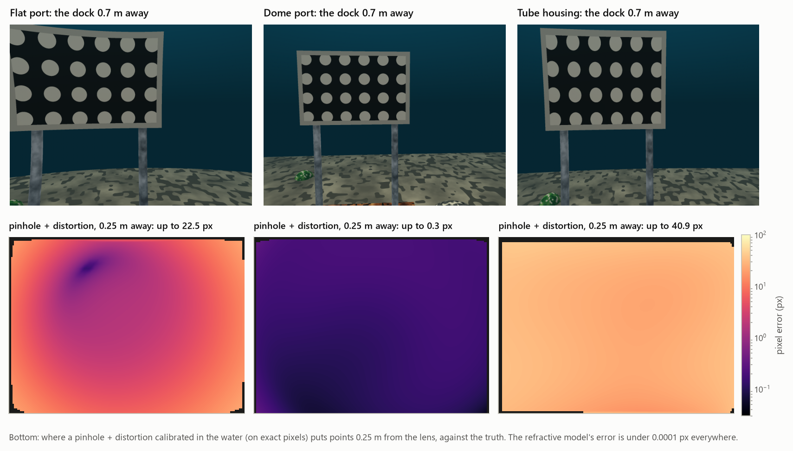
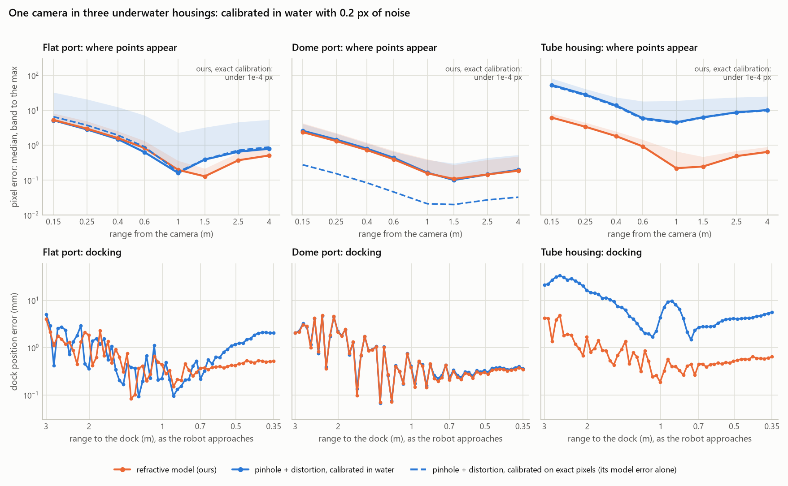

# Demo E: a robot's camera in an underwater housing

```sh
python examples/demo_e_housing/demo_e.py        # calibrations, errors by range, docking: ~4 min
python examples/demo_e_housing/figures.py       # summary.png, views.png, docking.gif: ~15 min (renders cached)
```

It needs `pip install .[housing]` (matplotlib, Pillow and OpenCV). Renders are cached in `_cache/` (set
`REFCAM_CACHE` to put them elsewhere).


An underwater robot's camera sits in air, behind a port, and looks out through it into the water. Behind a dome or
inside a tube it is the camera **inside** a curved window. The usual practice is to calibrate a pinhole camera with
lens distortion **in the water**, so that the distortion absorbs the port's refraction. This demo asks when that is
enough. It places one camera in three housings and compares that practice with the refractive model.

## The housings

The camera is 1280 × 960 px with f = 812 px (the datasheet says 800). It is built a little off its drawing:
- its entrance pupil is 1–6 mm from where the drawing puts it;
- its axis is about a degree off;
- its principal point is 5 px off.

| Housing | Port | The camera in it, as built |
|---|---|---|
| **flat port** | acrylic, 10 mm thick, 20 mm in front of the lens | the pupil 1.5 mm further back |
| **dome port** | acrylic dome, outer radius 50 mm, 5 mm wall | the pupil 6 mm in front of the dome's centre, 1 mm aside |
| **tube housing** | acrylic tube, outer radius 50 mm, 5 mm wall, vertical; the camera looks out through its side, as on many low-cost robots | the lens 17 mm in front of the axis (15 mm on the drawing) |



**The truth** is computed by tracing alone (`housing.shoot`): each dot's ray is found by Gauss–Newton on the
traced ray's miss, with vector Snell's law at every interface and none of the model's closed forms. The renders use
the package's ray tracer, `refractive_camera.scene`.

## Calibration in the water

Both models see the same 30 views of a 9 × 7 dot board 0.25–1.5 m away, 1,890 dots in all. They are calibrated
twice:
- **on the exact pixels**, which leaves each model's own error;
- **with 0.2 px of noise** on every dot, as a real calibration has.

| Model | What it fits |
|---|---|
| **pinhole + distortion** | OpenCV's `calibrateCamera`: focal lengths, principal point and five distortion coefficients (k1, k2, p1, p2, k3) |
| **refractive (ours)** | the housing as drawn (radii, thickness, indices). Unknowns: the lens's intrinsics and the camera's pose in the housing, fitted by Levenberg–Marquardt with the analytic derivatives of `image_jacobians` (`calibrate.py`) |

The boards' poses are unknown to both. The housing's symmetries cannot be seen in the images (a dome's turn about
its centre; a tube's turn about its axis and slide along it; a flat port's slide along its plane). A weak prior
keeps the refractive model's camera near its drawn pose along them.

**Fits.**

| Housing | Pinhole + distortion: rms, exact / noisy | Ours: rms, exact / noisy | Ours: the camera's position in the housing, exact / noisy |
|---|---:|---:|---:|
| flat port | 0.066 / 0.286 px | 0.000 / 0.197 px | 4e-5 / 0.83 mm |
| dome port | 0.005 / 0.274 px | 0.000 / 0.194 px | 5e-6 / 0.53 mm |
| tube housing | 0.967 / 1.012 px | 0.000 / 0.196 px | 4e-6 / 0.90 mm |

Both models are placed in the robot's frame the same way. Each gets the rigid motion that best maps the calibration
boards' poses as it estimated them onto their true poses: a perfect hand–eye calibration.

## Where points appear

Points 0.15–4 m from the lens, on a 25 × 19 grid over the image, are projected by each model and compared with the
traced truth (`demo_e_out.txt`).

**Each model's own error** (calibrated on exact pixels), median / max:

| Range | Flat port: pinhole + dist. | Dome port: pinhole + dist. | Tube housing: pinhole + dist. | Ours, any housing |
|---|---:|---:|---:|---:|
| 0.15 m | 6.6 / 40.4 px | 0.28 / 0.45 px | 50.2 / 76.9 px | < 0.0001 px |
| 1 m | 0.17 / 1.9 px | 0.02 / 0.28 px | 4.4 / 19.1 px | < 0.0001 px |
| 4 m | 0.89 / 6.2 px | 0.03 / 0.30 px | 9.9 / 24.7 px | < 0.0001 px |

**With 0.2 px of noise in the calibration,** median / max:

| Range | Flat: pinhole + dist. | Flat: ours | Dome: pinhole + dist. | Dome: ours | Tube: pinhole + dist. | Tube: ours |
|---|---:|---:|---:|---:|---:|---:|
| 0.15 m | 5.2 / 32.8 px | 5.3 / 8.3 px | 2.6 / 4.1 px | 2.4 / 4.3 px | 53.7 / 82.9 px | 6.2 / 8.1 px |
| 1 m | 0.16 / 2.3 px | 0.20 / 0.36 px | 0.17 / 0.39 px | 0.16 / 0.40 px | 4.6 / 18.9 px | 0.22 / 0.67 px |
| 4 m | 0.80 / 5.4 px | 0.51 / 0.84 px | 0.20 / 0.53 px | 0.19 / 0.48 px | 10.3 / 25.3 px | 0.65 / 0.90 px |



## Docking

The robot approaches a dock, a 6 × 4 dot board 0.4 m wide on two posts. It comes from 3 m to 0.35 m, swaying ±0.2 m
and turning ±8°, in 60 frames. In each frame both models, from their noisy calibrations, estimate the dock's pose from
its visible dots (0.2 px noise):
- the pinhole with OpenCV's `solvePnP`;
- ours with Levenberg–Marquardt on `project()` and `image_jacobians`, started from a plain PnP.

The dock's position and orientation error in the robot's frame, median / max:

| Housing | Range | Pinhole + distortion | Ours |
|---|---|---:|---:|
| flat port | 1–3 m | 0.68 / 5.1 mm, 0.39° / 1.7° | 0.68 / 4.1 mm, 0.46° / 1.8° |
| | 0.35–1 m | 0.64 / 2.1 mm, 0.30° / 0.50° | **0.40 / 0.54 mm, 0.06° / 0.14°** |
| dome port | 1–3 m | 1.05 / 4.7 mm, 0.46° / 2.9° | 1.01 / 4.9 mm, 0.44° / 2.8° |
| | 0.35–1 m | 0.33 / 0.49 mm, 0.06° / 0.24° | 0.31 / 0.52 mm, 0.05° / 0.23° |
| tube housing | 1–3 m | 11.4 / 33.2 mm, 3.4° / 5.3° | **0.88 / 4.8 mm, 0.43° / 2.1°** |
| | 0.35–1 m | 4.1 / 9.7 mm, 1.5° / 2.6° | **0.48 / 0.66 mm, 0.05° / 0.17°** |

## What it shows

- **A dome port is nearly a pinhole camera.** With the pupil 6 mm off its centre, a pinhole + distortion calibrated
  in the water stays within 0.45 px of the truth from 0.15 m to 4 m, and the two models tie in docking.
  - The refractive model adds what a dome's drawing cannot: it locates the camera in the dome, here to 0.5 mm.
  - Close to the camera both are limited by the same thing: the noise in the calibration's estimate of where the
    camera sits. About 0.5 mm is 2.7 px at 0.15 m.
- **A flat port is a pinhole camera far away, but not close up.**
  - The pinhole + distortion's own error grows from 0.2 px at 1 m to 40 px at the image's edge at 0.15 m, where the
    port's refraction depends on depth.
  - In the final metre of docking, ours estimates the dock's orientation five times better (0.06° against 0.30°).
- **A tube housing is not a pinhole camera at any range.**
  - Along its axis the tube's wall is straight and refracts like a flat port, which depends on depth; across the
    axis it is curved and refracts like a dome. OpenCV's distortion depends mainly on the distance from the image's
    centre and cannot absorb that: its fit stays at 1 px rms even on exact pixels.
  - Its predictions are 4–10 px off at 1–4 m and 50 px off at 0.15 m (medians).
  - Docking with it puts the dock 11 mm and 3.4° off at 1–3 m (medians). Ours puts it 0.9 mm and 0.4° off there, and
    0.5 mm and 0.05° off in the final metre.

## Files

| File | What |
|---|---|
| `housing.py` | the camera, the three housings (as drawn and as built), the dot boards, the tracing-only truth |
| `calibrate.py` | both calibrations, OpenCV's PnP and the refractive PnP, the hand–eye alignment |
| `demo_e.py` | the experiment; writes `results.json` and `demo_e_out.txt` |
| `dock_scene.py` | the underwater scene: the dock, sand, rocks, light from above and the water's haze |
| `figures.py` | `summary.png`, `views.png`, `docking.gif` |
